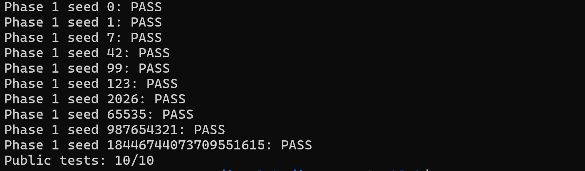
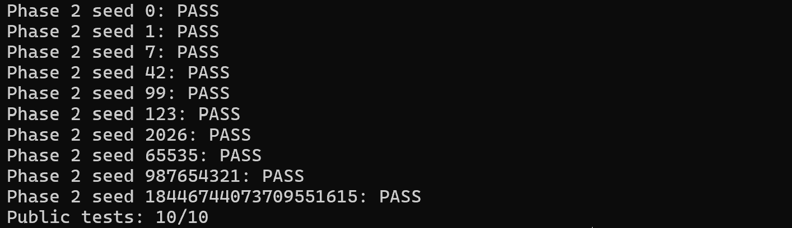
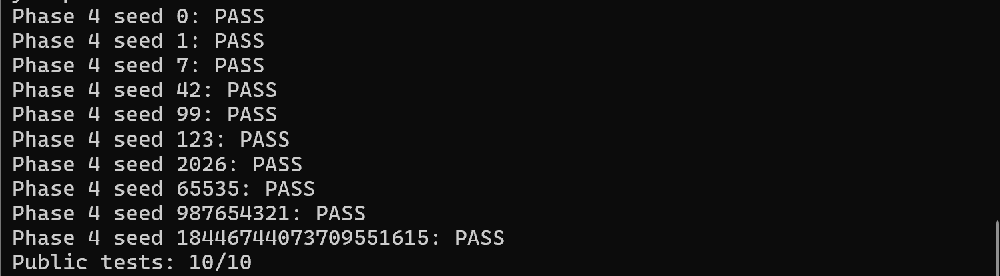
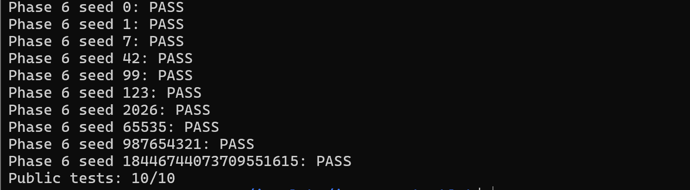
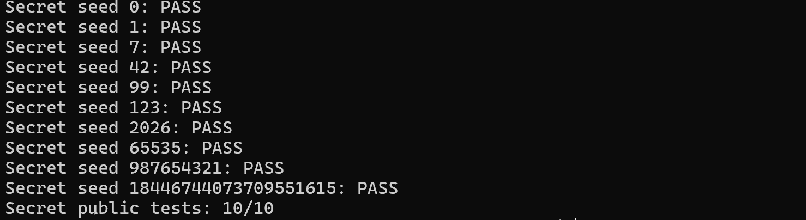
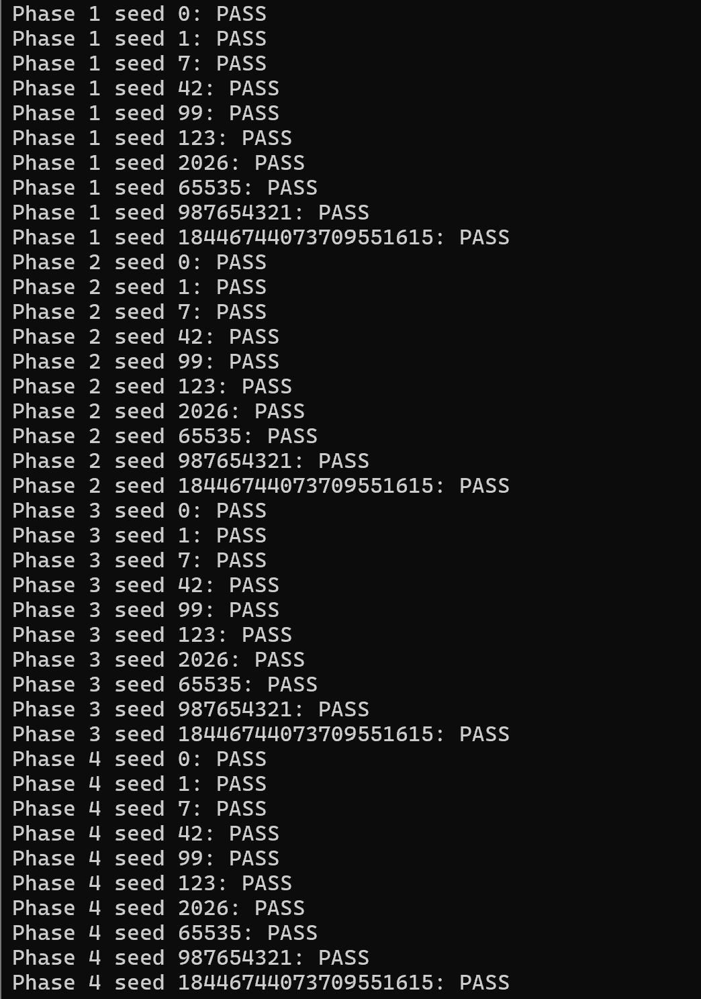
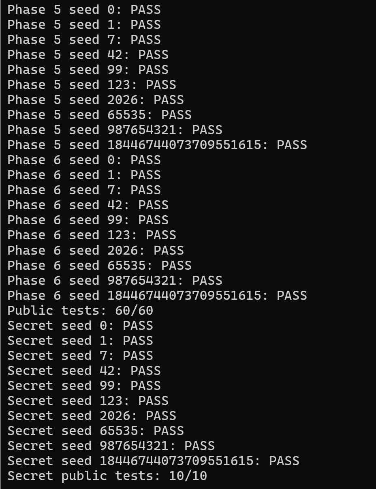
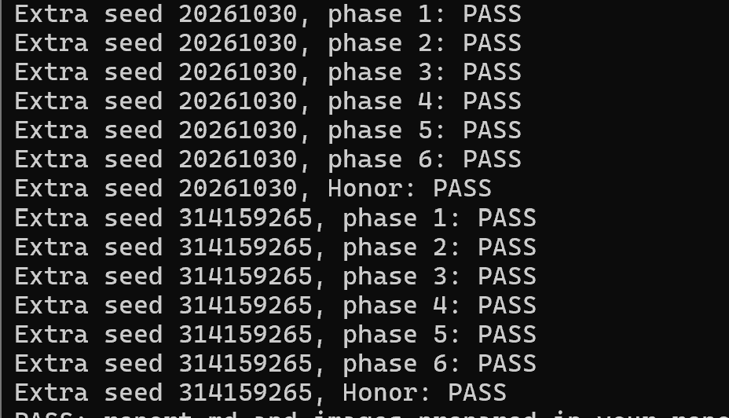

# BombLab 实验报告

## 1. 环境与方法

环境为 WSL Ubuntu 22.04 x86-64，使用 GCC、Make、Python 3 和 GDB。实验通过分析个人炸弹的汇编，恢复从 challenge 到口令的计算关系，并在 defuser.c 中实现。write_answer 只负责将结果写成口令字符串。

下文 C 表示 challenge，U32(x) 表示取低32位，^ 表示异或。32位运算按无符号数回绕；seed 由驱动转换为 challenge，不能直接当作 challenge 代入。

## 2. 第一关：函数调用

phase_01 读取一个整数，与 p1_compute 的返回值比较。展开三个辅助函数，追踪参数和 eax 返回值，得到：

```asm
# step0：5倍、加第二参数、异或常量
lea (%rdi,%rdi,4),%eax
add %esi,%eax
xor $0xb64d,%eax
# step1、step2的核心乘加
lea 0x1cb7(%rsi),%eax
lea (%rdi,%rsi,8),%eax
```

令 L=U32(C)、H=U32(C>>32)、M=U32(C>>16)：

```text
a = (5*L + H) ^ 46669
b = (M + 7351) ^ H
answer = ((b + 8*L) ^ 42398) ^ a
```

各辅助函数没有破坏用于保存中间结果的寄存器。口令为一个整数 answer。



## 3. 第二关：数组与递推

解析调用准备六个相差4字节的栈地址，并要求返回字段数为6。后续以4字节步长遍历，因此将其记为 x[0]～x[5]。

```asm
shr $0x5,%rax
and $0x1f,%eax
lea (%rax,%rax,2),%eax
# 循环核心：前一项左移，与challenge片段异或，再加常量
shl $0x2,%edx
shr %cl,%rax
and $0x3f,%eax
xor %edx,%eax
add %edi,%eax
```

```text
x[0] = 3 * ((C >> 5) & 31)
对 i=1..5：
  x[i] = ((x[i-1] << 2) ^ ((C >> (16+5*(i-1))) & 63)) + 9*i
```

循环中移位数每次加5、加数每次加9、指针每次加4，移位计数更新到41时退出。口令为六个整数。



## 4. 第三关：跳转表

第一个输入必须等于 k=C&7，另一个参数为 t=U32(C>>3)^U32(C>>32)。dispatch 的关键指令为：

```asm
mov %edi,%eax
mov %esi,%edi
cmp $0x7,%eax
ja 0x402295
notrack jmp *0x405820(,%rax,8)
```

通过 `x/8ga 0x405820` 读取表项，而不是按代码排列顺序猜测分支。结果如下：

| k | case函数 | result |
| ---: | ---: | --- |
| 0 | 6 | (t ^ 1601) + (t >> 1) |
| 1 | 0 | (t ^ 3877) + (t >> 1) |
| 2 | 4 | (t * 2) ^ 13664 |
| 3 | 2 | t * 5 + 14559 |
| 4 | 7 | t * 3 + 48450 |
| 5 | 1 | (t * 4) ^ 38510 |
| 6 | 5 | t * 5 + 189135 |
| 7 | 3 | t * 5 + 68460 |

各 case 通过移位、lea 乘加和异或实现表中的关系。间接 jmp 只进入选中的分支，case 的 ret 直接返回外层。口令为 k 和 result。


## 5. 第四关：递归

外层调用 walk(target,0,127,key)，其中 target=C&127，key=U32(C>>7)^U32(C>>32)。

```asm
mov %edi,%eax
mov %edx,%edi
sub %esi,%edi
shr %edi
add %esi,%edi
cmp %eax,%edi
je 0x402380
```

目标先保存到 eax，edi 随后被覆盖为中点，不能把同一寄存器始终当作同一变量。每层计算 mid=low+(high-low)/2：

```text
target==mid：返回 (mid+128)^key
target<mid：child=walk(target,low,mid-1,key)
            返回 (child*5)^(mid+key)^29
target>mid：child=walk(target,mid+1,high,key)
            返回 (child*5)^(mid+key)^20
```

左分支通过 `lea -1(%rdi),%edx` 改第三参数，右分支通过 `lea 1(%rdi),%esi` 改第二参数。每层用 ebx 保存 mid+key，递归返回后乘5并异或；相等分支终止递归。口令是最外层返回值。



## 6. 第五关：链表

```asm
mov 0x405b60(,%rax,8),%rdx
mov 0x4(%rdx),%esi
add (%rdx),%eax
mov %esi,(%r8)
mov 0x8(%rdx),%rdx
```

偏移0、4读取两个4字节字段，偏移8读取下一地址，说明数据可恢复为16字节节点 {a,b,next}。最后一条是读取 next 指针，不是将地址加8。用 `x/8ga 0x405b60` 和 `x/48uw 0x405ba0` 观察得到：

| 节点 | a | b | next |
| ---: | ---: | ---: | ---: |
| 0 | 20793 | 2416 | 5 |
| 1 | 31871 | 1920 | 4 |
| 2 | 23266 | 2910 | 1 |
| 3 | 8250 | 44 | 2 |
| 4 | 19500 | 1148 | 空 |
| 5 | 1943 | 2609 | 8 |
| 6 | 48114 | 2071 | 9 |
| 7 | 52941 | 526 | 10 |
| 8 | 440 | 1410 | 3 |
| 9 | 56721 | 881 | 11 |
| 10 | 13902 | 324 | 0 |
| 11 | 7528 | 1558 | 7 |

heads=[6,9,11,7,10,0,5,8]，起点为 heads[C&7]。初始 state=U32(C>>6)^U32(C>>32)^8670。先处理起点，再沿 next 走 (C>>3)&3 次，每次更新：

```text
state = (state*3 + node.a) ^ node.b
```

AND 后的 JE 根据 AND 设置的零标志判断是否跳过后续遍历。普通返回值是最终 state，指针输出是最后节点的 b，口令依次输出这两个数。


## 7. 第六关：函数指针

```asm
and $0x38,%ebx
and $0x7,%eax
call *0x405e00(,%rax,8)
xor $0xb263,%eax
mov %eax,%edi
call *0x405e00(%rbx)
add $0x5aec,%eax
```

两次间接 call 使用同一函数表。第一次编号 i=C&7，第二次编号 j=(C>>3)&7；and 56 得到的是第二次表项的字节偏移。表索引0～7分别对应 op_[4,2,4,5,0,3,5,1]。

| 函数 | 对输入 x 的计算 |
| --- | --- |
| op_0 | ((x<<5)+42170)^(7*x) |
| op_1 | 32位循环右移2位 |
| op_2 | ((x>>7)^x)+35792 |
| op_3 | (x^7950)+4*x |
| op_4 | 32位循环左移2位，再异或28937 |
| op_5 | (x+55498)^(x>>7) |

ROL/ROR 把移出的位接回另一端，可用两次移位和按位或实现。完整关系为：

```text
x = U32(C>>6)^U32(C>>32)
y = ops[i](x)^45667
answer = ops[j](y)+23276
```

第二次调用的输入来自第一次结果，不是原来的 x。最终只输出 answer。



## 8. Honor：入口与混合校验

```asm
lea -0xd0(%rbp),%r12
call secret_copy
cmpl $0x4e45504f,-0xb0(%rbp)
lea -0xac(%rbp),%rdi
call secret_phase
```

复制起点为 rbp-208，比较点为 rbp-176，偏移32字节；常量按小端序对应 OPEN。secret_phase 从偏移36处解析三个无符号整数。strlen 检查要求整行36～163字节。因此构造“32个A + OPEN + 空格 + 三个整数”，不需要覆盖返回地址。

secret_mix 的 `ror $5,%eax; xor $0x2228,%eax` 表示32位循环右移5位后异或8744。令 K=context，恢复关系为：

```text
a = U32(K)&3
u = U32(C>>32)^U32(C)
v = U32(K>>32)^U32(K)
w = (a*1776)^U32(K>>16)
x = u^v
b = (((x>>5)|(x<<27))^8744)^w
c = b^(v+a+9432+(u>>5))
```

使用 snprintf 写出完整第七行并检查截断，不添加换行。context 由驱动从前六行生成；验证 Honor 时需将同一 seed 的前六行与第七行一起交给 bomb。



## 9. 验证记录

强制重新编译后，原公开测试正式六关60/60、Honor 10/10。截图如下，公开通过不代表隐藏测试必然通过。





另核对 tests/public.json，确认以下两个 seed 不在公开列表中。逐关检查进程退出码和通过标记；Honor 额外要求六关与 Secret phase defused. 全部出现。

| 关卡 | seed 20261030 | seed 314159265 |
| --- | --- | --- |
| 1 | PASS | PASS |
| 2 | PASS | PASS |
| 3 | PASS | PASS |
| 4 | PASS | PASS |
| 5 | PASS | PASS |
| 6 | PASS | PASS |
| Honor | PASS | PASS |



复现命令，将 N 换成1～6；另一个 seed 同理：

```bash
./defuser --seed 20261030 --phase N | ./bomb --seed 20261030 --phase N
{ ./defuser --seed 20261030; ./defuser --secret --seed 20261030; } | ./bomb --seed 20261030
```

## 10. 学习体会

最初我对基本汇编、寄存器宽度和压栈出栈都不熟悉。把 rsp 保存的地址与栈中的数据分开理解后，才逐渐看懂保存和恢复现场。第四关也让我注意到，同一个寄存器会先后保存不同含义的数据，不能只记名字而忽略执行顺序。

位运算方面，我学会用右移将需要的位移到低位，再用掩码保留指定范围；固定常量异或是在翻转相应位，不等于筛选位。第五关起初只看到地址偏移，后来理解“读取 next 指针”与“地址直接加8”的区别，才认出链表结构。

## 11. 辅助工具使用说明

本实验使用 ChatGPT 辅助理解汇编指令和部分代码逻辑。完成实验后，使用其协助整理报告并检查代码、测试记录和提交材料。

## 12. 参考资料

1. [课程实验说明](https://ics-26fall-fdu.github.io/labs/lab2-bomb-lab/)。
2. [实验模板](https://github.com/ICS-26Fall-FDU/BombLab)中的 README、AGENTS.md 和 tutor/ 教学材料。

